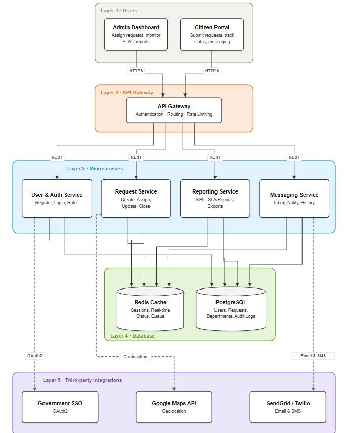
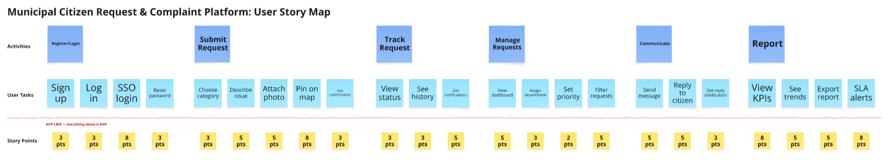

# Workshop: Lean Post-Agile Planning and Budgeting Strategies

**Team Members:** Nicolas Parrado · Hildebrandon Peña · Santiago Garcia

## Case Study: Municipal Citizen Request & Complaint Management Platform

A web-based platform that allows citizens to submit service requests (public lighting, waste management, infrastructure), track their status, and communicate with local authorities. Administrators can assign requests to departments, monitor resolution times, and generate performance reports.

---

## Deliverables

| File | Description |
|------|-------------|
| [architecture.md](./architecture.md) | High-level system architecture |
| [backlog.md](./backlog.md) | Agile Product Backlog (Epics + User Stories) |
| [budget.md](./budget.md) | Development Budget Estimate |
| [budget.xlsx](./budget.xlsx) | Development Budget (Excel) |
| [architecture.png](./architecture.png) | System Architecture Diagram |
| [user-story-map.png](./user-story-map.png) | User Story Map Diagram |

---

## System Architecture Diagram

---

## User Story Map

---

## How Budgets Are Produced in Scrum

1. **Estimate effort** in story points using Planning Poker (Fibonacci: 1, 2, 3, 5, 8, 13…)
2. **Measure velocity** = story points completed per sprint (e.g., 40 pts / 2-week sprint)
3. **Calculate cost per sprint** = team salaries + tools + overhead
4. **Estimate sprints needed** = total story points ÷ velocity
5. **Budget** = cost per sprint × number of sprints

> Story points represent **complexity + uncertainty + effort**, not time directly.
